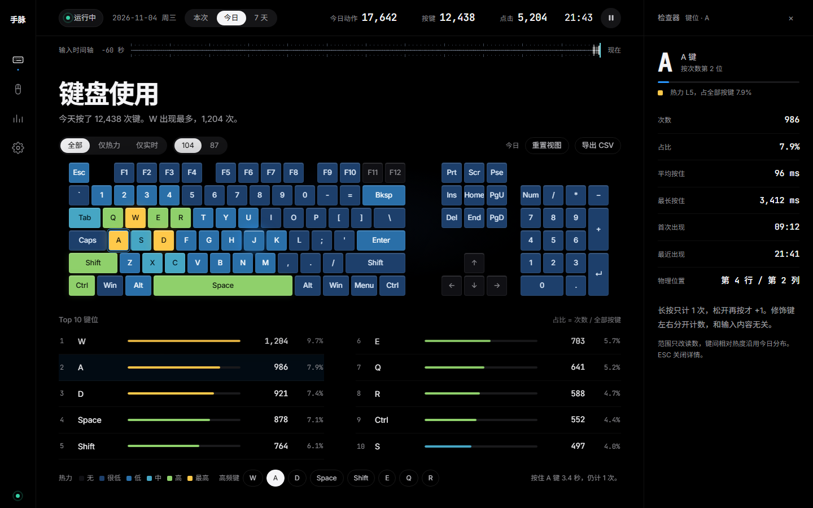
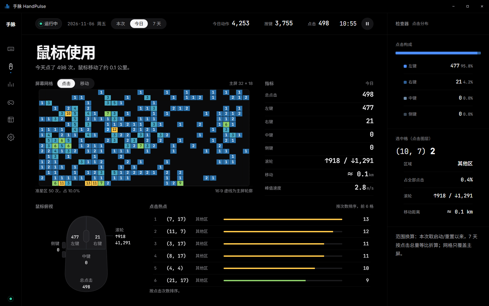
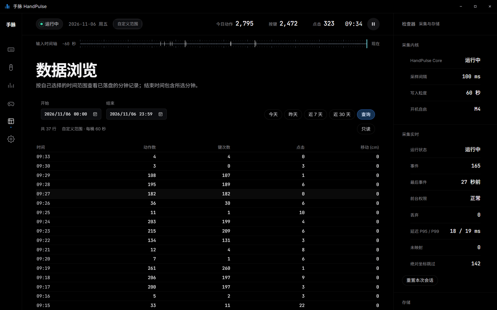
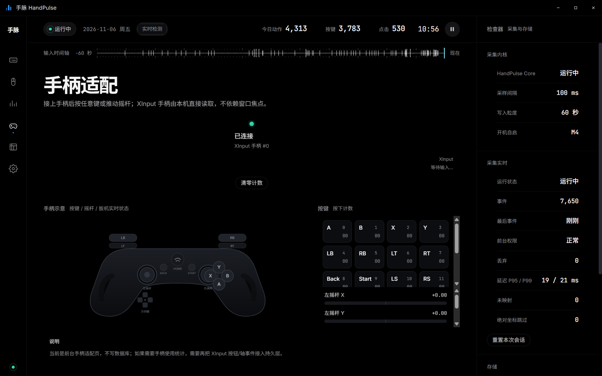

# 手脉 HandPulse

Windows 本地键盘 / 鼠标 / 手柄使用分析工具。所有统计都在本机完成：不联网、不读取输入内容、不记录按键顺序，只保存聚合后的次数、时长、点击与移动距离。

> 当前版本：**0.9.8**，Windows 10/11 x64，Tauri 2 + React 19 + Rust。
> 安装包尚未做 Windows 代码签名，首次运行会出现 SmartScreen 提示。

## 功能

- **键盘**：104 键热力、Top 键、按住时长、今日 / 7 天 / 本月 / 本次会话。
- **鼠标**：32×18 主屏网格、点击热点、按键构成、移动距离、滚轮、峰值速度。
- **手柄**：Xbox / PlayStation / Switch 三套示意图；XInput 实时读取按键、摇杆、扳机；按键计入分钟桶。
- **数据浏览**：自定义开始/结束时间，查看总览 / 键盘 / 鼠标 / 手柄详情。
- **数据展示**：7×24、日历、月历热力图，趋势与分布图。
- **常驻**：系统托盘、后台采集、单实例、关闭行为记忆。
- **数据管理**：SQLite 本地库、保留期清理、备份 / 导入 / 清空。

## 截图

| 键盘 | 鼠标 |
|---|---|
|  |  |

| 数据浏览 | 手柄 |
|---|---|
|  |  |

## 下载与安装

从 GitHub Releases 下载：

- `HandPulse_<version>_x64-setup.exe`（NSIS，推荐）
- `HandPulse_<version>_x64_en-US.msi`

直接覆盖安装即可升级；数据库在 `%APPDATA%\com.handpulse.desktop\data.db`，不随安装目录删除。升级前建议在设置里备份 `data.db`。

## 技术栈

- Tauri 2 / Rust 2024
- React 19 / TypeScript / Vite
- Windows Raw Input（键鼠）/ XInput（手柄）
- SQLite WAL + 后台 Writer
- 自绘标题栏、托盘、单实例

## 本地开发

需要 Node.js、Rust stable、Windows WebView2。

```powershell
cd app
npm install
npm run tauri dev
```

浏览器预览（没有真实采集，回退 mock）：

```powershell
npm run dev
# http://localhost:1420/#/keyboard
```

## 构建

```powershell
cd app
npm run build
npm run tauri build

# app/src-tauri/target/release/bundle/nsis/
# app/src-tauri/target/release/bundle/msi/
```

Rust 检查：

```powershell
cd app/src-tauri
cargo test
cargo clippy --all-targets -- -D warnings
```

## 目录

```
app/                 Tauri + React 主工程
  src/               前端页面、组件、IPC
  src-tauri/         Rust 采集、存储、命令
.github/workflows/   CI 与 GitHub Release
docs/                需求、落地文档、发布说明
design-demos/        早期视觉原型（保留）
screenshots 等       app/screenshots
```

## 隐私

- 只记录物理键位 ID 的聚合次数和时长，不记录字符内容；
- 鼠标只记录点击次数、移动距离、屏幕网格落点，不记录光标轨迹原文；
- 不上传、不联网；
- 数据全部在本地 SQLite。

## 发布与签名

- GitHub Actions 工作流见 `.github/workflows/release.yml`；
- 版本标签形如 `v0.9.9`，推送后生成草稿 Release；
- 自动更新还需要配置 Tauri updater 公钥、签名私钥和 `latest.json`；
- Windows 代码签名证书不是自动更新的硬性前提，但能减少 SmartScreen 拦截。

详细步骤见 [docs/GITHUB_PUBLISH.md](docs/GITHUB_PUBLISH.md)。

## 状态与限制

- 仅 Windows x64；macOS/Linux 未适配；
- 未签名安装包会有 SmartScreen 提示；
- PS / Switch 手柄的实际数据读取依赖系统暴露方式；当前 XInput 链路完整，其他手柄可能需要 HID/WebHID；
- 自动更新尚未接入，当前通过安装新版本覆盖升级。

## License

尚未添加开源许可证；在添加 LICENSE 前，默认保留所有权利。
